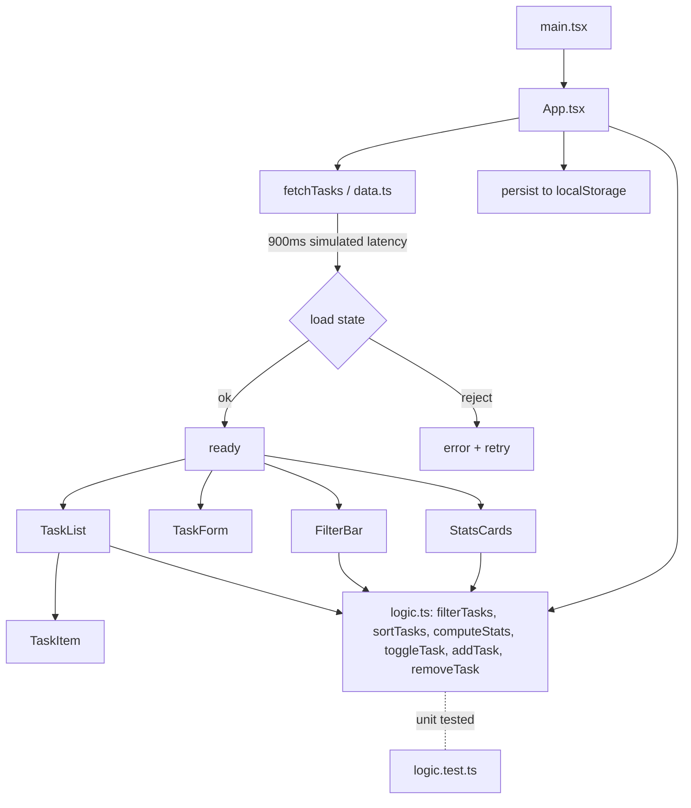

# TaskBoard

A task dashboard demo built with **React 18 + TypeScript + Vite** by Ghulam Ghous.
Search, filter, sort, add, complete and delete tasks, with live stats, simulated
async loading, and localStorage persistence.

**Live demo:** _(deploy `dist/` to Netlify and put the URL here)_
**Demo state hooks:** append `?demo=error` to see the error state, `?demo=empty` for the empty state.

## Run it

```bash
npm install
npm run dev      # local dev server
npm run build    # typecheck (tsc) + production build into dist/
npm test         # vitest unit tests
```

Deploy: drag-drop the `dist/` folder on Netlify (or `netlify deploy --dir=dist`).

## Architecture



- **UI state** lives in `App.tsx` (`tasks`, `loadState`, `filters`).
- **Business logic** lives in `logic.ts` as pure functions, no React imports,
  so it is unit-tested with Vitest (10 tests, all passing).
- **Data layer** (`data.ts`) simulates a backend: seed data on first run,
  localStorage after that, 900ms latency, `?demo=error|empty` hooks.

## Design decisions

- **Vite instead of Next.js** for this demo: the app is fully client-side with
  no server needs, so a static Vite build deploys anywhere with zero config.
  (Next.js noted as the next learning step.)
- **No component library, no Tailwind**: hand-written CSS keeps the bundle
  small and shows CSS fundamentals (custom checkbox, skeleton shimmer,
  responsive grid, `prefers-reduced-motion`).
- **Pure logic module**: filtering/sorting/stats are framework-free, which
  makes them trivially testable and reusable.
- **Derived state via `useMemo`**: visible tasks and stats recompute only
  when inputs change.
- **Honest states**: loading skeletons, an error state with retry, and an
  empty state are all real UI, not afterthoughts.

## Limitations (known, not hidden)

- No backend: tasks live in the browser's localStorage only. Multi-device
  sync and auth are out of scope for this demo.
- The `?demo=error|empty` hooks are demo tooling, documented here so nobody
  mistakes them for real failure modes.
- No virtualized list: fine for hundreds of tasks, not for tens of thousands.
- Dates use the browser locale; no timezone handling beyond ISO strings.

## AI-assisted development notes

This project was built with AI assistance (Muse) under the developer's
direction: the developer chose the product idea, stack and feature list;
the AI scaffolded the code, which the developer then reviewed, tested
(`npm test`, `npm run build`) and owns. All logic is covered by unit tests
so future changes stay safe. Suggested next steps for learning: replace the
simulated fetch with a real REST API, add React Router for task detail
pages, and try the same app in Next.js to compare.
